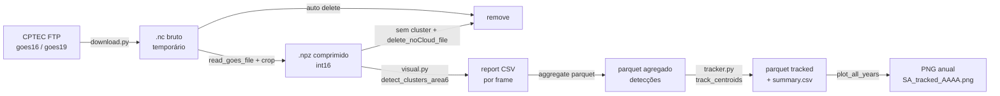

# GOES Data Pipeline (CPTEC/INPE)

Pipeline automatizado para **download**, **conversão**, **detecção** e **rastreamento temporal** de sistemas convectivos (MCS) em dados dos satélites **GOES-16** e **GOES-19**, servidos pelo CPTEC/INPE. Focado no **Canal 13 (infravermelho, ~10.3 µm)** e em análise sobre a América do Sul.

---

## 🌟 Destaques

- **Seleção automática de satélite** — GOES-16 para datas até **03/2025** e GOES-19 a partir de **04/2025**. A troca acontece por ano/mês, sem intervenção manual.
- **Download paralelo** — múltiplos workers baixam simultaneamente usando `ProcessPoolExecutor`, com sessão HTTP persistente, retries exponenciais e cap automático em `CPU-1`.
- **Pipeline end-to-end** — baixa o NetCDF, aplica recorte espacial, converte para `.npz` comprimido (int16, ~5-10× menor) e apaga o bruto.
- **Três backends de processamento** — serial (debug), multiprocessing (padrão) e MPI dinâmico master/worker (cluster / multi-nó).
- **Detecção de clusters frios** — smoothing gaussiano, máscara geográfica da América do Sul, filtragem por área mínima e temperatura mínima, com geração opcional de relatório CSV + figura Cartopy.
- **Rastreamento temporal** — conecta detecções frame-a-frame em trajetórias de MCS com `haversine` vetorizada e atribuição gulosa ou Hungarian, produzindo parquet + sumário CSV + mapas anuais.
- **Idempotente** — reexecuções pulam automaticamente arquivos já processados (`.npz` existente, relatório presente ou parquet de tracks presente).
- **Multiplataforma** — layout de pastas ajustado para Windows, workstation Linux local (via sshfs) e servidor Linux headless.

---

## 📂 Arquitetura do Repositório

| Arquivo | Função Principal |
| :--- | :--- |
| `download.py` | Orquestrador do download. CLI, lista arquivos do CPTEC, escolhe GOES-16/19 e dispara workers paralelos. |
| `converter.py` | Conversão NetCDF → `.npz` (int16 comprimido). Helpers de timestamp e de destino. |
| `detector.py` | Detecção de clusters convectivos (connected components via `skimage.label` + filtros de área/temperatura), leitura de `.nc`/`.npz`, plotagem com Cartopy. |
| `visual.py` | Pipeline principal de detecção sobre o banco `.npz`. Três backends: serial, multiprocessing, MPI. |
| `visual_terminal.py` | Wrapper CLI fino sobre `visual.main` (flags `--server`, `--parallel`, `--mpi`, `-w`, `-o`). |
| `tracker.py` | Rastreamento temporal de clusters (haversine vetorizada, atribuição gulosa ou Hungarian, plot anual com Cartopy). |
| `tracker_terminal.py` | Wrapper CLI fino sobre `tracker.track_centroids` (flags `--input`, `--output`, `--min-area`, `--max-km`, `--assignment`, `--bbox`, `--plot`). |
| `mask_SouthAmerica.npz` | Pré-computado: coordenadas, `extent` e máscara booleana da América do Sul. |
| `.gitignore` | Bloqueia binários pesados (`.nc`, `.npz` grandes, figuras, caches). |

---

## 🛠️ Requisitos

### Python (>= 3.10 recomendado)

```bash
pip install numpy requests beautifulsoup4 tqdm xarray netCDF4 \
            scipy scikit-image matplotlib cartopy pandas pyarrow
```

- `scipy` também é usado pelo tracker quando `--assignment hungarian`.
- `pyarrow` (ou `fastparquet`) é necessário para ler/escrever os parquets de detecções e de tracks.

Opcional (só necessário para o backend MPI):

```bash
pip install mpi4py
```

### Dados de apoio

- `mask_SouthAmerica.npz` deve estar no diretório de trabalho. Contém as chaves `lats`, `lons`, `extent` e `mask` usadas pelo recorte regional e pela detecção.

---

## 🔄 Fluxo do Pipeline



Em uma frase: **cada arquivo do CPTEC vira um `.npz` regional, que vira um relatório (e opcionalmente uma figura) quando contém um cluster frio; o conjunto dos relatórios é agregado em um parquet e o tracker conecta as detecções ao longo do tempo em trajetórias de MCS.**

---

## 🚀 Uso

### 1. Download + conversão (`download.py`)

```bash
# Exemplo completo (servidor remoto, 10 workers, março-outubro de 2025)
python download.py -y 2025 -m 3 4 5 6 7 8 9 10 --server -w 10

# Um dia específico
python download.py -y 2021 -m 10 -d 23 -w 8
```

Flags:

| Flag | Descrição | Default |
| :--- | :--- | :--- |
| `-y`, `--year` | Ano (obrigatório) | — |
| `-m`, `--months` | Lista de meses (ex: `3 4 5`) | ano inteiro |
| `-d`, `--days` | Lista de dias do mês | mês inteiro |
| `-c`, `--channel` | Canal GOES (1–16) | `13` |
| `-w`, `--workers` | Processos paralelos (cap em CPU-1) | auto |
| `-t`, `--timeout` | Timeout HTTP em segundos | `30` |
| `--server` | Usa layout de pastas do servidor | off |

### 2. Detecção de clusters (`visual_terminal.py`)

```bash
# Backend paralelo, 40 workers, saída separada por sufixo
python visual_terminal.py --parallel --server -w 40 -o _big

# Backend MPI (requer mpirun + mpi4py)
mpirun -n 16 python visual_terminal.py --mpi --server
```

Flags:

| Flag | Descrição |
| :--- | :--- |
| `--parallel` | Usa `multiprocessing.Pool`. |
| `--mpi` | Usa backend MPI dinâmico master/worker. |
| `--server` | Usa o layout de pastas do servidor. |
| `-w`, `--workers` | Workers do backend paralelo. |
| `-o`, `--output_key` | Sufixo adicionado a `figures/` e `reports/` (útil para rodar vários parâmetros lado a lado). |

### 3. Rastreamento de trajetórias (`tracker_terminal.py`)

Consome o parquet agregado das detecções (resultado dos `reports/*.txt` concatenados) e produz (i) um parquet com `track_id` atribuído, (ii) um `*_summary.csv` com início/fim de cada trilha e (iii) opcionalmente mapas anuais com início (azul) e fim (vermelho) de cada trajetória.

```bash
# Pipeline completo: tracking + sumário + mapas por ano
python tracker_terminal.py --server \
    --input database_numpy/c13_2018-2025_SouthAmerica.parquet \
    --output tracks/c13_2018-2025_SA_Tracked.parquet \
    --min-area 600000 --max-km 35 --min-points 60 \
    --assignment hungarian \
    --bbox -40 -12 -67 -42 --plot -v

# Reusar um parquet tracked existente apenas para replotar
python tracker_terminal.py --from-tracked tracks/c13_2018-2025_SA_Tracked.parquet \
    --plot --bbox -40 -12 -67 -42
```

Flags:

| Flag | Descrição | Default |
| :--- | :--- | :--- |
| `--input` | Parquet de detecções agregadas. | — |
| `--output` | Parquet de saída com `track_id`. | `tracks/c13_tracked<KEY>.parquet` |
| `--from-tracked` | Pula o tracking e usa um parquet pronto (só replota). | — |
| `--force` | Recalcula mesmo se o parquet de saída existir. | off |
| `--max-gap` | Gap temporal máximo entre observações. | `20min` |
| `--max-km` | Distância máxima entre obs consecutivas (km). | `35` |
| `--max-speed` | Velocidade máxima (km/h); `0` desliga. | `120` |
| `--min-points` | Mínimo de observações por trilha. | `60` |
| `--assignment` | `greedy` (rápido) ou `hungarian` (ótimo por frame). | `greedy` |
| `--min-area` | Filtra detecções com `area_km2 >= MIN_AREA`. | off |
| `--bbox` | `LAT_MIN LAT_MAX LON_MIN LON_MAX` para recorte. | off |
| `--plot` | Gera um PNG por ano com as trajetórias. | off |
| `-o`, `--output_key` | Sufixo para as pastas de saída. | `""` |
| `--server` | Layout de pastas do servidor. | off |
| `-v`, `--verbose` | Verbosidade do logging (`-v`, `-vv`). | off |

---

## ⚙️ Parâmetros de Detecção

Editáveis no dicionário `OPTIONS` dentro de `visual.main`:

| Chave | Significado | Valor típico |
| :--- | :--- | :--- |
| `region_temperature_threshold` | Pixels iniciais: T < valor (°C) | `-33` |
| `min_temperature_threshold` | Cluster precisa atingir esta T mínima (°C) | `-65` |
| `min_area_km2` | Área mínima do cluster (km²) | `75_000` |
| `smooth_sigma` | Raio do filtro gaussiano (pixels) | `20.0` |
| `delete_noCloud_file` | Apaga `.npz` sem cluster para liberar espaço | `True` |
| `extent` | `[lon_min, lon_max, lat_min, lat_max]` | vindo do `mask_SouthAmerica.npz` |

### Parâmetros de Tracking

Editáveis via CLI (`tracker_terminal.py`) ou via `TrackerOptions` no código (`tracker.py`):

| Chave | Significado | Valor típico |
| :--- | :--- | :--- |
| `max_time_gap` | Tolerância entre frames (scan nominal 10 min). | `20min` |
| `max_km` | Deslocamento máximo entre obs consecutivas. | `35 km` |
| `max_speed_kmh` | Corta pulos implausíveis. | `120 km/h` |
| `min_points` | Mínimo de obs para não descartar a trilha. | `60` |
| `assignment` | `greedy` (N log N por frame) ou `hungarian` (ótimo por frame). | `greedy` |
| `min_area_km2` | Filtro de MCS antes do tracking. | `600 000` |
| `bbox` | `(lat_min, lat_max, lon_min, lon_max)` para sub-região. | `(-40, -12, -67, -42)` |

---

## 📁 Estrutura de Saída

```
database_numpy/
└── 2021/
    └── 10/
        └── S10635346_202110231700.npz

figures/
└── 2021/
    └── 296/                              # dia-do-ano (DOY)
        └── C13_2021-296_1700.png

reports/
└── 2021/
    └── 296/
        └── C13_2021-296_1700.txt         # CSV por cluster detectado

tracks/
├── c13_2018-2025_SA_Tracked.parquet       # detecções + track_id
└── c13_2018-2025_SA_Tracked_summary.csv   # uma linha por trilha

figures_tracks/
└── tracked/
    ├── SA_tracked_2018.png
    ├── SA_tracked_2019.png
    └── ...
```

Cada relatório de detecção contém uma linha por cluster com as colunas `centroid_lat, centroid_lon, area_km2, temp_min_C, temp_mean_C, temp_std_C, n_clusters`. O sumário de tracking contém uma linha por trilha com `track_id, t0, t1, lat0, lon0, lat1, lon1, n_points`.

---

## 🗂️ Layout de Pastas por Ambiente

Selecionado automaticamente em `defining_folders` (`download.py`, `tracker_terminal.py`) e no início de `visual.main`:

| Ambiente | Detecção | Raiz do banco |
| :--- | :--- | :--- |
| Windows | `os.name == "nt"` | `D:/banco_dados/cptec/database_numpy` |
| Linux local | `os.name == "posix"` sem `--server` | `~/database/cptec/database_numpy` |
| Linux servidor | `os.name == "posix"` + `--server` | `~/database_numpy` |

No caminho local, normalmente o diretório é montado via `sshfs`:

```bash
sshfs hisashi@150.163.46.4:/home/hisashi/database/cptec ~/cptec \
    -o reconnect,uid=$(id -u),gid=$(id -g),default_permissions,umask=0002
```

---

## 📝 Notas

- O corte GOES-16 / GOES-19 está codificado em `_SATELLITE_CUTOFF_YYYYMM = 202504` (`download.py`). Se o CPTEC alterar a data, edite essa única constante.
- Reexecuções são seguras: `.npz` já presente = download pulado; `report` já presente = detecção pulada; `tracks/*.parquet` já presente = tracking pulado. Use `--force` no `tracker_terminal.py` para recalcular.
- `.npz` são salvos em `int16` com fator de escala `×100` (centésimos de °C). A leitura em `read_npz_goes` já divide por 100 automaticamente.
- Em erros de leitura o `.npz` é deletado (considerado corrompido). Em ambiente de produção, ajuste esse comportamento em `process_file_parallel` se quiser uma pasta de quarentena em vez de deleção.
- O backend MPI depende de `mpi4py`; rode com `mpirun`/`mpiexec`.
- O `tracker.py` é vetorizado frame-a-frame: em cada timestamp, calcula a matriz `haversine` entre detecções e trilhas ativas de uma só vez. Evite loops `iterrows` ao estender.
- Blacklists manuais de `track_id` **não são reprodutíveis** (os IDs mudam a cada execução). Se alguma trilha precisa ser removida, prefira critérios objetivos (`min_points`, `max_speed_kmh`, `min_area_km2`) que sobrevivem a uma reexecução.